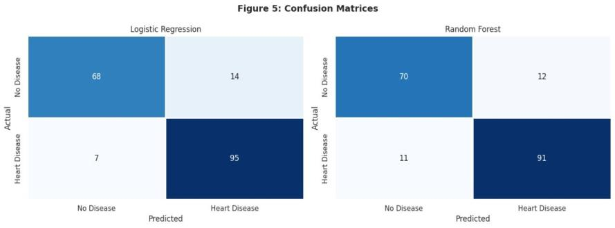
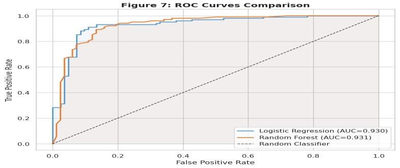
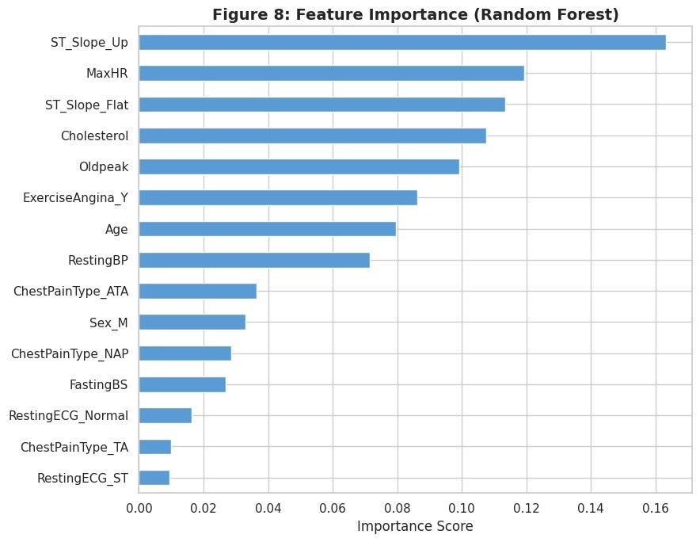

# Heart Disease Prediction Using Machine Learning

A machine learning project that predicts the presence of heart disease from clinical patient data, comparing Logistic Regression and Random Forest classifiers.

**Course:** Data Analysis 1 (DS2313) — Umm Al-Qura University
**Dataset:** [UCI Heart Failure Prediction Dataset](https://www.kaggle.com/datasets/fedesoriano/heart-failure-prediction) (Kaggle)

## Overview

Cardiovascular disease causes an estimated 17.9 million deaths per year (WHO). Traditional diagnosis can be costly and time-consuming, so this project explores whether machine learning can reliably predict heart disease from routine clinical measurements — and which features matter most.

**Research Questions**
1. Can ML reliably predict heart disease from clinical data?
2. Which clinical features are the most influential risk factors?
3. How do Logistic Regression and Random Forest compare?

## Dataset

- **918 patient records**, 12 clinical features (age, sex, chest pain type, resting blood pressure, cholesterol, fasting blood sugar, resting ECG, max heart rate, exercise-induced angina, ST depression, ST slope)
- Target distribution: 55.3% heart disease, 44.7% no disease
- No missing values or duplicate rows

## Methodology

| Step | Details |
|---|---|
| Data Cleaning | Verified no missing values or duplicates |
| Encoding | One-hot encoding for categorical features |
| Scaling | StandardScaler applied (for Logistic Regression) |
| Split | 80% train (734 samples) / 20% test (184 samples), stratified |
| Validation | Stratified 5-fold cross-validation |
| Models | Logistic Regression, Random Forest (100 trees) |
| Metrics | Accuracy, Precision, Recall, F1-Score, AUC-ROC |

## Results

| Metric | Logistic Regression | Random Forest |
|---|---|---|
| Accuracy | **88.6%** | 87.5% |
| Recall | **93.1%** | 89.2% |
| F1-Score | **0.900** | 0.888 |
| AUC-ROC | 0.930 | **0.931** |
| 5-Fold CV F1 | 0.8669 | 0.8679 |

Cross-validation scores closely matched test scores for both models, indicating no significant overfitting. **Logistic Regression** was selected as the best overall model based on F1-score and recall — an important consideration for a screening tool, where minimizing missed diagnoses (false negatives) matters most.

### Top Predictive Features (Random Forest importance)

1. **ST_Slope (Up)** — an upward slope reflects a healthy cardiac response to exercise
2. **Max Heart Rate** — lower max heart rate is linked to disease
3. **Cholesterol** — a key cardiovascular risk factor
4. **Oldpeak** (ST depression) — a direct indicator of ischemia
5. **Exercise-Induced Angina** — chest pain under exertion suggests reduced coronary blood flow

## Tech Stack

Python · pandas · NumPy · scikit-learn · matplotlib · seaborn

## Future Work

- Enrich features with blood pressure history and family medical records
- Train on a larger, more diverse patient population for better generalization
- Apply hyperparameter tuning to further improve model performance

## Repository Contents

- `heart_disease_prediction.py` — full pipeline: EDA, preprocessing, model training, evaluation, and plots
- `confusion_matrices.png`, `roc_curves.png`, `feature_importance.png` — result figures
- Dataset: download `heart.csv` from [Kaggle](https://www.kaggle.com/datasets/fedesoriano/heart-failure-prediction) and place it next to the script

## Team

Group project (4 students), supervised by Dr. Moudy Alshareef.
